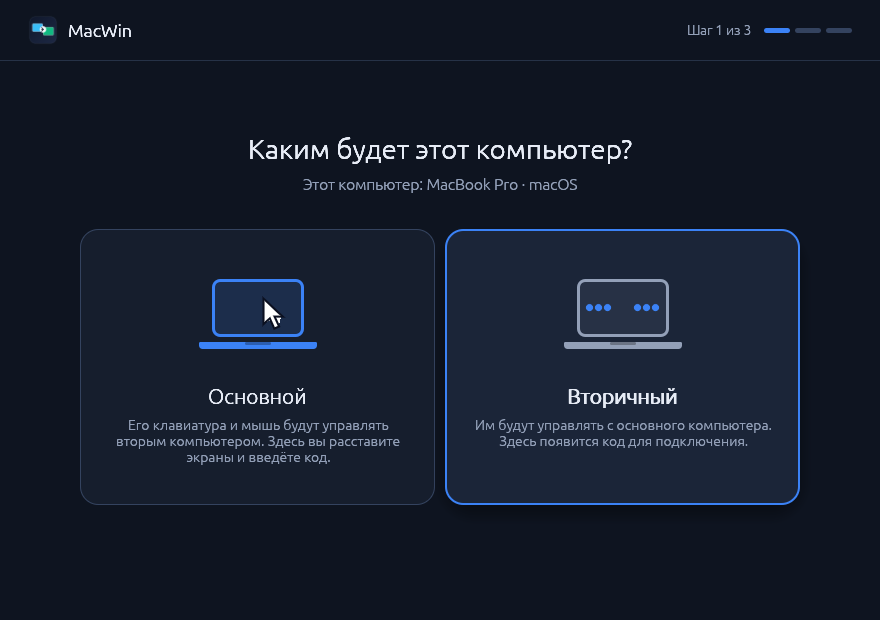
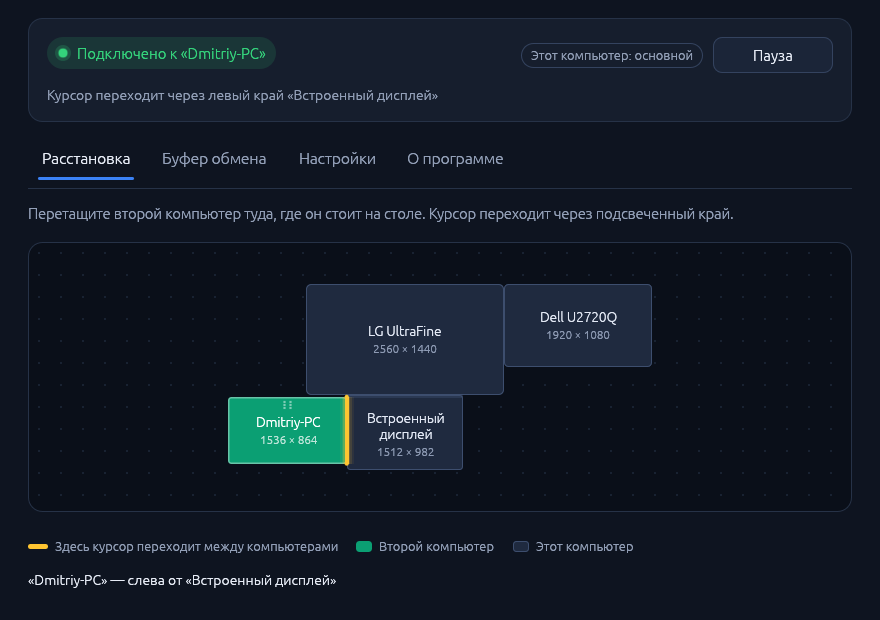

#  MacWin (MacWin Bridge)

A software KVM for one Mac and one Windows PC on the same LAN: either
machine's keyboard and mouse can drive both screens, and copied text,
images and files are shared between them.

**Status: 0.2, test build.** On top of Phase 3 (pairing by a one-time code,
Keychain / DPAPI identity, keyboard and mouse sharing with smooth scrolling,
clipboard sharing of text, images and files, reconnects, start at login,
installable packages), MacWin becomes a normal application: a window with a
first-run wizard (this computer is the **primary** or the **secondary**), a
drag-and-drop screen arrangement editor that places the other computer next to
any of your monitors on any edge, and pairing by entering the secondary's code
on the primary. The menu bar / notification area icon stays for quick access.
The window is wired to the agent in one process, and native CI builds, tests
and packages it on macOS and Windows; the real OS backends and the window still
need testing on physical hardware.

<p>


</p>

Plan and per-stage status: [PLAN.md](PLAN.md) and issue [#10](https://github.com/asintiko/macwin/issues/10) (Russian).
Next: [PLAN-0.3.md](PLAN-0.3.md) — latency measurement and speed-ups, Linux (Kali) support, several computers (Russian).
Current progress, verification results and remaining work: [PROGRESS.md](PROGRESS.md) (Russian).
First-run instructions and the hardware checklist: [FIRST_RUN.md](FIRST_RUN.md) (Russian).
Test downloads: [latest release](https://github.com/djjdjdkdjdvdvd/macwin/releases/latest)
(see [Installing](#installing)). The DMG requires macOS 15+ on Apple Silicon; the
Windows ZIP contains x64 EXEs and `install.cmd`. Test builds are not
distribution-signed; the one-line installers below avoid the Gatekeeper and
SmartScreen prompts, and CI notarizes the Mac build once a Developer ID
certificate is configured.

## Workspace

| Path | What it is |
|---|---|
| `crates/macwin-core` | Pure logic: vocabulary types, screen arrangement (placement, snapping, shared edges) and edge crossing, HID keymap, Ctrl/Cmd remap, pressed-key tracking, heartbeat, emergency chord, the controller state machine (`Engine`), clipboard sync ordering. No I/O, threads or clocks. |
| `crates/macwin-proto` | Strict protobuf codec (hand-written `prost` derives, no `protoc`), stream framing, version check. |
| `crates/macwin-net` | QUIC (quinn + rustls/ring) with mutual TLS and SHA-256 certificate pinning; SPAKE2 pairing; identity bundles; the `Link` abstraction. |
| `crates/macwin-platform` | Backend traits (capture, injection, screens, clipboard, secret store), the tray view model, and in-memory fakes (`testing` feature). |
| `crates/macwin-platform-macos` | macOS backend: CGEventTap capture, CGEventPost injection, displays, NSPasteboard, login keychain, menu bar item (empty on other OSes). |
| `crates/macwin-platform-windows` | Windows backend: low-level hooks, SendInput, per-monitor-v2 DPI, Win32 clipboard, DPAPI, `Run` key, notification area icon (empty on other OSes). |
| `crates/macwin-ui` | The application window (egui/eframe with OpenGL): first-run wizard, arrangement editor, status and settings. Talks to the agent through its `Backend` trait; `examples/demo.rs` runs it with a fake backend. |
| `crates/macwin-agent` | Session driver, reconnecting runner, LAN discovery use, the controller behind the window and the tray, config (library) and the `macwin` / `macwin-tray` binaries. |
| `scripts/macos` | Builds and signs `target/MacWin.app`, packs it into a dmg, runs it through LaunchServices, stops it. |
| `scripts/windows` | Builds the Windows zip; `install.ps1` / `uninstall.ps1` inside it. |
| `tools/keymap-gen` | Generates the HID <-> macOS keycode <-> Windows scancode table from Chromium data. |

## Building

`rust-toolchain.toml` pins Rust 1.96.0. If your `stable` toolchain already is
1.96.0, you can run every command with `RUSTUP_TOOLCHAIN=stable` instead of
installing the pinned one:

```sh
rustup toolchain install 1.96.0 --profile minimal -c rustfmt,clippy -t x86_64-pc-windows-gnu
cargo test --workspace --all-features
cargo build --release -p macwin-agent          # target/release/macwin
```

### Windows binaries from a Mac

```sh
brew install mingw-w64                          # provides x86_64-w64-mingw32-gcc
cargo build --release -p macwin-agent --target x86_64-pc-windows-gnu
# -> target/x86_64-pc-windows-gnu/release/macwin.exe and macwin-tray.exe
```

Windows CI builds natively with MSVC.

### Packages

```sh
scripts/macos/dmg.sh          # target/MacWin-<version>-macos-arm64.dmg (builds and signs MacWin.app)
scripts/windows/package.sh    # target/MacWin-<version>-windows-x64.exe + target/macwin-<version>-windows-x64.zip
```

CI builds both and keeps artifacts of the `package` jobs for 14 days; a pushed
tag `v*` publishes them as a GitHub release with stable names
(`MacWin-macos-arm64.dmg`, `MacWin-windows-x64.zip`, `MacWin-windows-x64.exe`,
`install-macos.sh`, `install-windows.ps1`, `SHA256SUMS.txt`). Check
[PROGRESS.md](PROGRESS.md) for the current CI status.

**Signing.** Without secrets the Mac build is signed ad-hoc. With the
repository secrets `MACOS_CERTIFICATE_P12` (a base64 "Developer ID
Application" certificate and key) and `MACOS_CERTIFICATE_PASSWORD`, CI signs
with the Hardened Runtime; with `APPLE_ID`, `APPLE_TEAM_ID` and
`APPLE_APP_PASSWORD` (an app-specific password) it also notarizes and staples
the dmg, which then opens on any Mac without a Gatekeeper prompt. Locally:
`MACWIN_SIGN_IDENTITY="Developer ID Application: …" scripts/macos/dmg.sh` with
`MACWIN_NOTARY_PROFILE` or the same variables. The Windows programs are not
signed.

## Installing

- **Mac** (macOS 15+, Apple Silicon), in Terminal:

  ```sh
  curl -fsSL https://github.com/djjdjdkdjdvdvd/macwin/releases/latest/download/install-macos.sh | bash
  ```

  It downloads the dmg (curl does not quarantine it, so Gatekeeper does not
  ask), quits a running MacWin, installs `/Applications/MacWin.app`, signs a
  test build for this Mac, resets the Accessibility / Input Monitoring entries
  if the signature changed (macOS would otherwise keep a stale, non-working
  grant) and opens MacWin. The same script is `Install MacWin.command` in the
  dmg. A notarized dmg can simply be dragged to Applications. Then grant the
  permissions described in [macOS permissions](#macos-app-bundle-and-permissions);
  the window shows their state and opens the right page of System Settings.
- **Windows** (x64), in PowerShell:

  ```powershell
  powershell -NoProfile -ExecutionPolicy Bypass -Command "irm https://github.com/djjdjdkdjdvdvd/macwin/releases/latest/download/install-windows.ps1 | iex"
  ```

  It downloads the zip without the "downloaded from the internet" mark (so
  SmartScreen does not stop the unsigned build), checks it against
  `SHA256SUMS.txt` and runs its `install.ps1` (below).
- **Windows (full installer ZIP):** extract the zip and double-click `install.cmd` (it runs
  `install.ps1`). It installs for the current user in
  `%LOCALAPPDATA%\Programs\macwin`, adds that folder to PATH and MacWin to the
  Start menu, starts MacWin in the background at login, allows UDP 47800-47801
  through Windows Firewall on private networks (one administrator prompt;
  `-AllNetworks` adds Public networks) and opens the MacWin window.
  `uninstall.ps1` removes it again; `-Purge` also deletes settings, identity,
  logs and received files. The installed uninstaller defaults to its own
  folder, including custom locations; unrelated files in that folder are kept.
- **Windows (single EXE, no installation):** `MacWin-windows-x64.exe` runs the
  app directly from where it is.

## Usage

Open MacWin (MacWin.app, the Start menu entry, `macwin-tray.exe` or
`macwin tray`): the window does everything below. Closing it keeps MacWin
running in the menu bar / notification area; **Open MacWin…** in the icon's menu
(on Windows also a click on the icon, or launching MacWin again) brings it back.
At login MacWin starts in the background without a window (`macwin tray
--background`, `macwin-tray.exe --background`). The same works from the command line; on a
Mac, run commands through the signed app bundle (`scripts/macos/run.sh
<command>`, see below) so that macOS grants its permissions and keychain access
to MacWin.app.

### 1. Pair the machines (once)

On the computer whose keyboard and mouse you want to use, choose **Primary**
in the first-run wizard. The next step shows your monitors as they are arranged
in the OS; drag the other computer to where it stands on the desk (it snaps to
the nearest monitor edge; the highlighted line is where the cursor will cross)
and continue. On the other computer choose **Secondary**: it shows a code.
Enter that code on the primary. The secondary receives the arrangement from the
primary with every connection, so it never asks for a side, and its own mouse
can cross back through the same edge. The arrangement can be changed later on
the primary's **Arrangement** tab, which then shows the other computer's real
screens.

Discovery uses IPv4 broadcast and may not cross VPNs, subnets or Wi-Fi client
isolation. If it fails, choose **Enter the address manually** on the primary
and type the address shown under the secondary's code, for example
`192.168.1.20:47800`. Both
machines must still be reachable over the network; this does not bypass a
firewall or client isolation.

From the command line (here the PC, whose screens are to the right of the
Mac, waits):

```sh
macwin.exe pair --side left
# listening on 0.0.0.0:47800
# pairing code: 123-456
# on the other machine run:
#   macwin pair --code 123456
# or, if it does not find this machine:
#   macwin pair 192.168.1.20:47800 --code 123456
```

```sh
scripts/macos/run.sh pair --code 123456
# found "DESKTOP-1" (windows) at 192.168.1.20:47800
# paired with "DESKTOP-1" (windows), fingerprint ...
# its screens are on the right of this machine
```

`--side` on either machine is enough; the other side is derived. Each code
works for one attempt: after a wrong code the waiting machine shows a new
one (at most 5 attempts, 10 minutes). The machine that dialed remembers the
address and dials it from then on; the other one listens. When that address
stops answering, the dialing machine asks the LAN where its peer is now and
keeps the new IP address.

### 2. Share

Open the tray app on both machines (or run `macwin.exe run` on the PC and
`scripts/macos/run.sh run` on the Mac).

Push the cursor over the shared edge to control the other machine; touch the
other machine's own mouse or keyboard to take control back. Trackpad and
Magic Mouse scrolling stays smooth on the PC. Sharing reconnects by itself
when the network drops or the other machine restarts. The emergency chord
**Ctrl+Alt+Shift+Esc** (Control+Option+Shift+Esc on a Mac) always returns
local control: it pauses the tray (**Resume sharing** continues) and stops
`run`. Only one macwin (tray or `run`) runs per user at a time.

The tray menu shows the state (waiting, connected, controlling, …) and has
**Pause sharing**, **Share clipboard**, the side of the other machine,
pairing, **Start at login** and **Quit**. Start at login also works with
`macwin autostart on|off|status` (a LaunchAgent on macOS, the `Run` key on
Windows). The tray logs to `~/Library/Logs/macwin/macwin.log` (Mac) or
`%LOCALAPPDATA%\macwin\macwin.log` (Windows).

What you copy appears on the other machine's clipboard:

- **Text**, up to `clipboard-max-kb` (4 MiB by default).
- **Images** (screenshots, pictures copied in a browser or an editor), as
  PNG, up to 64 MiB.
- **Files and folders** copied in Finder or Explorer, up to
  `clipboard-files-max-mb` in total (512 MiB by default). They are sent
  right away when copied and wait in the cache directory
  (`~/Library/Caches/macwin/incoming`, Windows `%LOCALAPPDATA%\macwin\incoming`,
  or `MACWIN_CACHE_DIR`); paste in Finder or Explorer copies them out. Only
  the latest copy is kept there, across reconnects. A copy travels whole
  or not at all: an unreadable item, a name with a backslash or more than
  65 536 items keep it on this machine. Symlinks are skipped, and names
  that Windows does not accept are adjusted (`a:b.txt` becomes `a_b.txt`).

When a copy holds several kinds (Word and Excel put text and a picture),
files win over text, and text over an image.

### Configuration

`config.toml` lives in the config directory
(`~/Library/Application Support/macwin`, Windows `%APPDATA%\macwin`,
or `MACWIN_CONFIG_DIR`):

```sh
macwin config show
macwin config set side right               # where the peer's screens are
macwin config set address pc.local:47800   # dial this; `none` = listen
macwin config set listen 0.0.0.0:47800
macwin config set remap off                # keep Ctrl and Cmd/Win as they are
macwin config set discovery off            # neither answer nor send LAN discovery
macwin config set discovery-port 47801     # UDP port of LAN discovery
macwin config set clipboard off            # stop sharing the clipboard
macwin config set clipboard-max-kb 4096    # largest shared text
macwin config set clipboard-images off     # text and files only
macwin config set clipboard-files off      # text and images only
macwin config set clipboard-files-max-mb 2048  # largest shared copy of files
macwin unpair                              # forget the peer
```

### Identity

Every machine has a self-signed identity, created on first use:

```sh
macwin identity
# fingerprint: 3f1c...e9 (64 hex digits)
# key: login keychain, item "io.macwin.MacWin" / "identity"
# config dir: ~/Library/Application Support/macwin
```

The certificate and key are kept in the login keychain on macOS and in a
DPAPI-encrypted `identity.dpapi` on Windows. `MACWIN_KEY_STORE=file` keeps
them in an unencrypted `identity.secret` (mode 0600) instead, for headless
machines and tests. Phase 0 identity files are moved into the store
automatically.

### Diagnostics and spikes

```sh
macwin probe screens                 # monitors in native coordinates
macwin probe permissions [--prompt]  # macOS: Accessibility, Input Monitoring, Secure Input
macwin probe clipboard [--watch]     # format names and sizes, never the content
macwin spike capture [--grab]        # print (and with --grab, swallow) local input
macwin spike inject --demo           # cursor draws a square, then "hello" is typed
macwin spike net --listen 0.0.0.0:47800 --peer-fp <hex>    # latency, with manual pins
macwin spike kvm --connect <host>:47800 --peer-fp <hex> --peer-side right
```

### macOS app bundle and permissions

macOS grants input permissions per app and per code signature, so run macwin
from a signed bundle:

```sh
scripts/macos/bundle.sh                       # builds and signs target/MacWin.app
scripts/macos/run.sh                          # the menu bar app
scripts/macos/run.sh probe permissions --prompt
scripts/macos/run.sh run                      # output in ~/Library/Logs/macwin/macwin.log
scripts/macos/stop.sh
```

Grant **Accessibility** and **Input Monitoring** to MacWin in
System Settings > Privacy & Security, and allow **Local Network** when asked.
On macOS versions that ask before apps read the clipboard, allow MacWin
under **Paste from Other Apps**. `bundle.sh` signs with
`MACWIN_SIGN_IDENTITY` or the first "Apple Development" identity, so the
permissions and keychain access survive rebuilds.

Known limits: windows of elevated (admin) Windows apps, the Windows lock
screen and UAC prompts do not accept remote input yet (the planned SYSTEM
service is designed in `.agents/tasks/phase4-design.md`); macOS Secure Input
(password fields) hides keystrokes from macwin while active. Copied files travel when they are
copied, not when they are pasted, so a large copy takes a moment to become
pasteable on the other machine. LAN discovery uses IPv4 broadcasts: across
subnets or VPNs, pair with an address and set `address` by hand.

Network: UDP 47800 carries sessions and pairing (QUIC), UDP 47801 LAN
discovery; the listening machine needs both open (the Windows installer adds
the firewall rules).

## Security model

- There is no unencrypted or unauthenticated session. Every connection is
  TLS 1.3 over QUIC with client certificates, and each side accepts exactly
  one peer, identified by the SHA-256 fingerprint of its certificate.
- Pairing (separate ALPN `macwin-pair/1`) runs SPAKE2 with the one-time code
  over a TLS connection that accepts any certificate. Both certificates'
  fingerprints and a TLS exporter value are bound into the SPAKE2 identities
  and the key confirmation, so a man in the middle needs the code, and each
  attempt tests at most one guess.
- The identity key lives in the Keychain / DPAPI (see above).
- LAN discovery is a hint, never trusted: a machine that answers still has
  to pass pairing (the code) or certificate pinning (sessions), so a forged
  answer costs at most one failed attempt. Queries for the paired peer name
  it by SHA-256 tags over a random nonce and both fingerprints, so the
  fingerprints are never broadcast and only the right machine answers; a
  machine waiting for pairing announces its name, OS and fingerprint to the
  LAN while it waits. `discovery = false` turns it off.
- Clipboard: each kind (text, images, files) is shared only while both
  machines enable it. Content marked private by password managers
  (`org.nspasteboard.Concealed` / `Transient`, Windows
  `ExcludeClipboardContentFromMonitorProcessing`,
  `CanUploadToCloudClipboard = 0`) is never sent, and clipboard content and
  file names are never logged. Received file paths are checked (no `..`,
  absolute paths or drive letters) before anything is written, and files
  are only ever written inside the cache directory.
- Emergency chord: **Ctrl+Alt+Shift+Esc** (Control+Option+Shift+Esc on a Mac).
  Capture backends check it on physical keys before anything is swallowed, and
  it always returns local control.

## Keymap data

`crates/macwin-core/src/keymap/generated.rs` is generated and checked in:

```sh
tools/keymap-gen/fetch.sh          # re-download Chromium's dom_code_data.inc (rarely needed)
cargo run -p keymap-gen            # regenerate
cargo run -p keymap-gen -- --check # CI: fails if the table is stale
```

## Licensing

Third-party data and its license are listed in `THIRD_PARTY_NOTICES`.
Dependencies must use permissive licenses; `deny.toml` (cargo-deny, run in CI)
enforces this. The project's own license is not decided yet.
